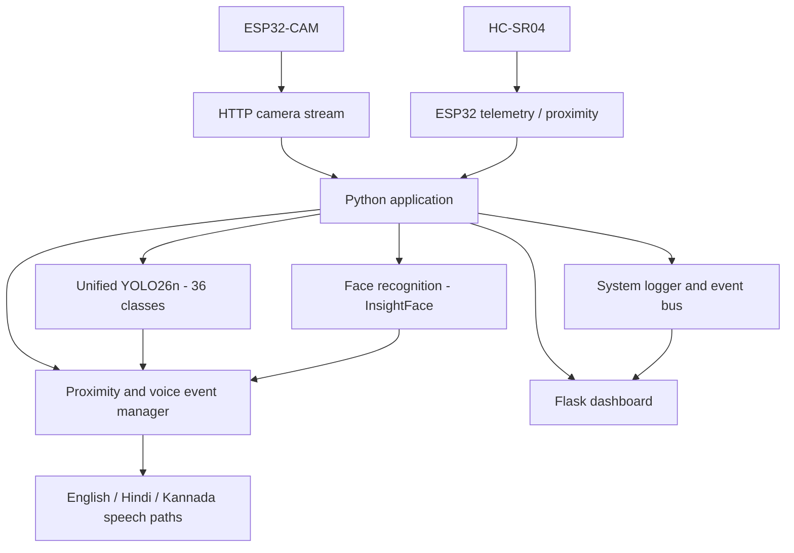

# Smart AI Vision Assistant — Edge System

A wearable assistive-vision prototype combining an ESP32-CAM video stream, real-time object detection, proximity sensing, face-recognition components, multilingual speech output, and a Flask-based monitoring dashboard.

> **Project status:** This repository documents the prototype and its handover code. Hardware-dependent behavior must be revalidated on the target computer, ESP32-CAM, and network before relying on it.

## Highlights

- **Camera streaming:** ESP32-CAM HTTP multipart stream and telemetry firmware.
- **Object detection:** Unified YOLO26n model trained for 36 classes (`Unified_Model_30ep.pt`).
- **Open-vocabulary extension concept:** YOLO-World V2.1 S was evaluated as a separate specialist option for rare/additional concepts; it is not merged into the primary detector in this package.
- **Proximity alerts:** HC-SR04 ultrasonic distance readings with configurable warning and critical thresholds.
- **Face recognition:** InsightFace-based enrollment and recognition components. No personal face database is included.
- **Speech output:** English through Windows native speech; Hindi and Kannada neural TTS are supported through their respective Piper-compatible ONNX voice models when the model files and matching configuration files are installed. The model files are obtained separately from their original sources; see the TTS setup and licensing notes below.
- **Dashboard and events:** Flask web interface, centralized logging, and a thread-safe event bus.

## System overview



## Repository layout

- `main_controller.py` — main application orchestration.
- `web_server.py` and `templates/index.html` — dashboard and web server.
- `config.py` — camera, detection, proximity, and voice settings.
- `esp32_camera.py`, `camera_source.py`, `camera_factory.py` — camera integration.
- `yolo_detector.py` — object detection wrapper.
- `face_enrollment_manager.py`, `face_recognition_manager.py` — face-recognition components.
- `proximity_manager.py`, `voice_event_manager.py`, `tts_manager.py` — proximity and speech/event handling.
- `system_logger.py`, `system_event_bus.py` — logs and in-memory event distribution.
- `ESP32_CAM_SMART_AI_ASSISTANT_LIVE_TELEMETRY/` — ESP32 firmware.
- `Unified_Model_30ep.pt` — primary detector weights.
- `INSTALL.txt` — fuller setup and troubleshooting notes.
- `requirements.txt` — Python dependency reference.
- `tts-test/` and `indic-tts-main/models/` — local TTS model/configuration paths. Voice models are not necessarily included in the public repository; download each required model and its matching configuration from the original source.

## Hardware

- ESP32-CAM-compatible board and camera sensor.
- HC-SR04 ultrasonic distance sensor (trigger and echo wiring must match the firmware and use appropriate echo-level voltage protection).
- Buzzer module.
- Wearable glasses frame and mounting hardware.
- Windows PC for running the Python AI pipeline and dashboard.

Pin assignments and camera settings can vary by board revision. Confirm wiring and the exact sensor before powering the hardware.

## Software requirements

- Windows 10/11, 64-bit.
- Python 3.11, 64-bit.
- VS Code or another Python IDE.
- A compatible ESP32 Arduino toolchain for firmware changes.
- Dependencies listed in `requirements.txt`.

## Quick start

1. Download or clone this repository.
2. Review `INSTALL.txt` before installing or running anything.
3. Install the dependencies in a dedicated Python environment that matches your hardware/software setup.
4. Open `config.py` and set `ESP32_IP` to the current IP address of your ESP32-CAM.
5. Open the `.ino` sketch and replace `YOUR_WIFI_SSID` and `YOUR_WIFI_PASSWORD` locally. **Do not commit your real credentials.**
6. Ensure the model and TTS assets are at the paths expected by the code.
7. Run the environment check in PowerShell:

   ```powershell
   Set-ExecutionPolicy -Scope Process -ExecutionPolicy Bypass
   .\setup_environment.ps1
   ```

8. Start the dashboard:

   ```powershell
   python .\web_server.py
   ```

9. Open `http://127.0.0.1:5000` on the same computer.

This quick start is a guide, not a guarantee that every dependency will install unchanged on every machine. Follow `INSTALL.txt` and resolve dependency/version compatibility for your environment.

## Speech-language notes

The application supports English (`en`), Hindi (`hi`), and Kannada (`kn`) speech output. English uses Windows native speech. Hindi and Kannada use Piper-compatible neural TTS with their respective ONNX voice models and matching configuration files. If neural TTS fails to initialize or play, the application falls back to Windows native speech. The Hindi and Kannada model files are obtained separately from their original sources; see the download links and licensing notes below.

### TTS model downloads and licensing

Download each voice model and its matching `.onnx.json` configuration file from its original source:

- **Hindi — Pratham, medium:** [Original model files](https://huggingface.co/rhasspy/piper-voices/tree/main/hi/hi_IN/pratham/medium)
- **Kannada — SYSPIN, medium:** [Kannada model source](https://huggingface.co/micahchoo/piper-kn)

Place the downloaded model and configuration files in the TTS model directory expected by your local configuration. Verify the configured paths before running the application.

**Licensing:** These are third-party assets and are not covered automatically by this project's license. Review the original model cards, model licenses, dataset terms, and attribution requirements before use or redistribution. The Kannada model source notes unresolved licensing implications and recommends non-commercial use. Do not assume that free, open-source distribution of this project grants permission to redistribute the voice models.

## Privacy and security

- Do not commit Wi-Fi passwords, API tokens, personal face images/embeddings, generated face databases, or runtime logs.
- Face recognition is sensitive personal-data processing. Enroll only people who have provided appropriate consent and protect enrollment data.
- The ESP32 sketch has been changed to credential placeholders for this public-ready copy.
- The local ESP32 IP in `config.py` is a generic example; configure it for your network.
- Review the complete code and any third-party assets/licenses before public deployment.

## Known limitations

- Camera streaming, telemetry, GPS workflow, detection performance, and voice availability depend on the local hardware, network, drivers, and installed speech voices.
- The handover validation notes cover selected development-computer checks; they do not establish performance on every target system.
- Hindi and Kannada neural voice models are large external assets obtained separately. Their availability and licensing must be checked before use or redistribution.

## Credits and contribution

This project was developed as an engineering prototype integrating embedded hardware, computer vision, real-time event handling, and speech output. Update this section with the exact individual/team contributions and collaborators before publishing.

## License

No license is declared yet. Until a license is added, others do not automatically receive permission to reuse, modify, or redistribute the project. Check the licenses for the model weights, TTS assets, and dependencies before choosing a repository license.

## Copyright and permissions

Copyright © 2026 Ateeb Baig. All rights reserved.

This repository is publicly available for project review, educational evaluation, and feedback. No license is granted for general reuse, modification, redistribution, or commercial use of the project code.

Please contact the author to request permission for any other use. Third-party components and assets remain subject to their respective licenses.

Viewing or forking this repository on GitHub does not grant additional rights beyond those permitted by applicable law and GitHub's terms.
